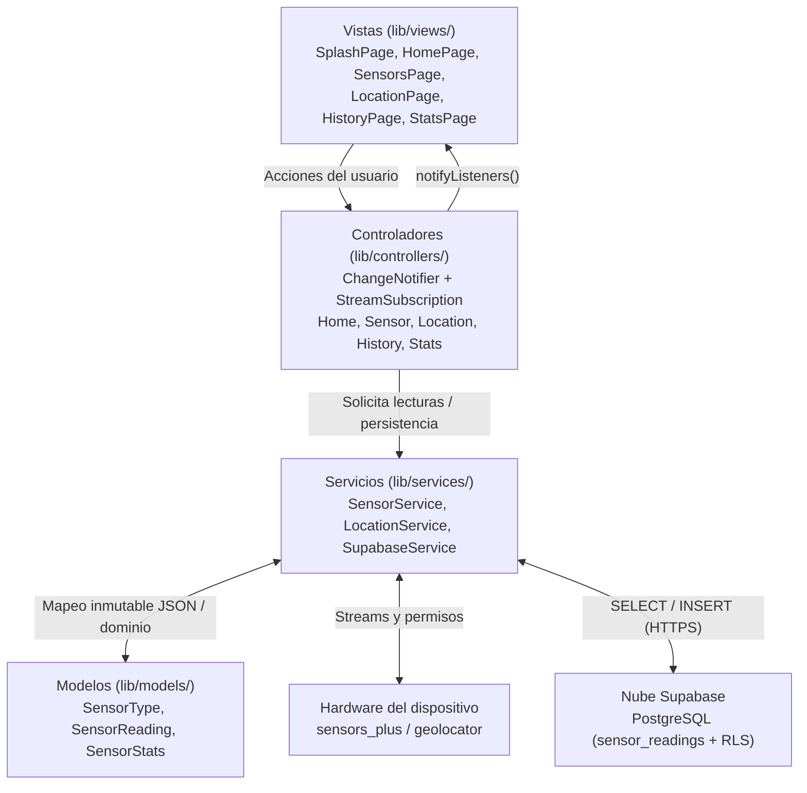
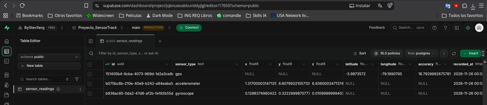
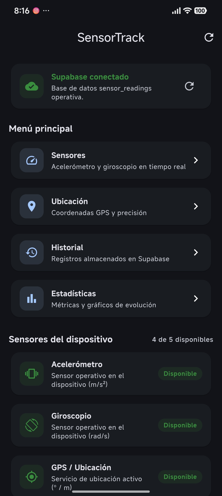
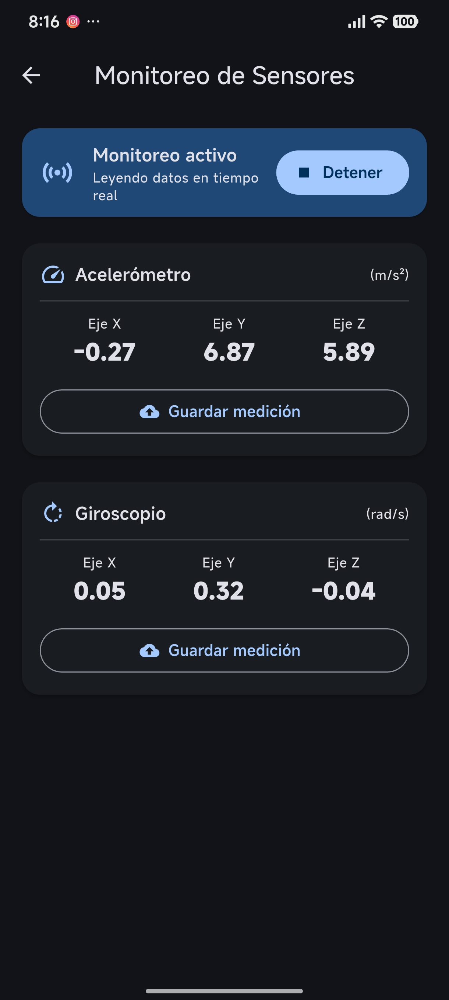
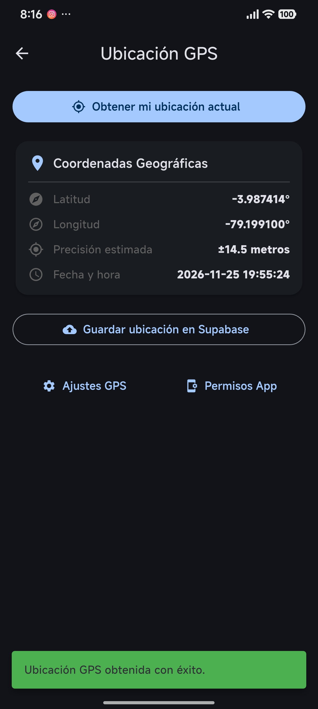
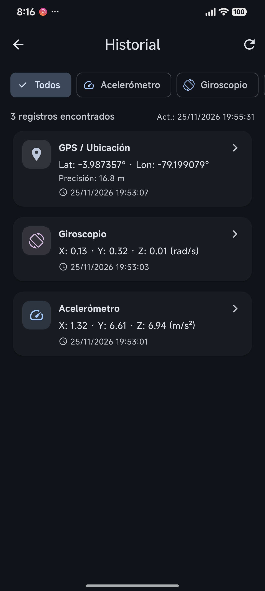
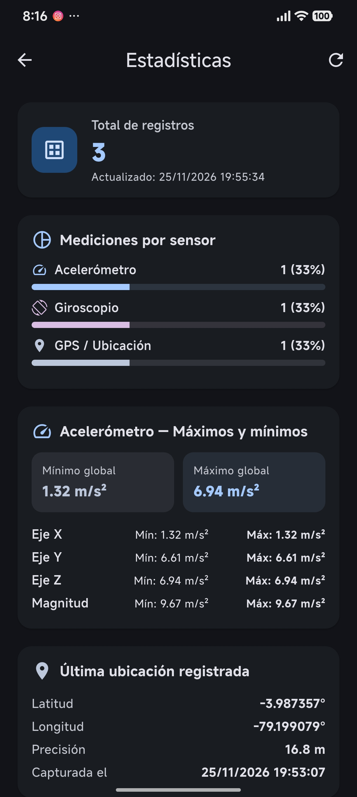
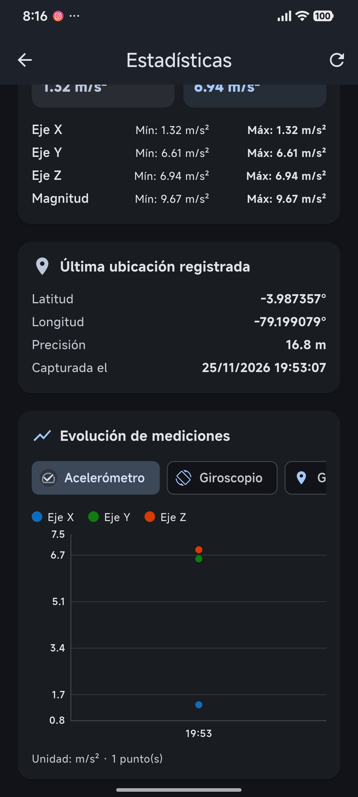

# Informe Técnico — SensorTrack

**Aplicación móvil con Flutter, sensores físicos y Supabase**

| Campo | Detalle |
| --- | --- |
| **Proyecto** | `SensorTrack` (`sensortrack_flutter`) |
| **Asignatura** | Desarrollo de Plataformas Móviles — Taller Práctico |
| **Repositorio GitHub** | <https://github.com/By-Alvarez06/SensorTrackFlutter> |
| **Integrantes** | Byron Alvarez (`By-Alvarez06`), Steven Benavides (`StevenBenavides`), Sergi Montaño (`ntnsergi`) |
| **Arquitectura** | Modelo – Vista – Controlador (MVC) con capa de Servicios |
| **Fecha** | Noviembre de 2026 |

---

## 1. Introducción y Objetivos

**SensorTrack** es una aplicación móvil multiplataforma desarrollada con **Flutter y Dart** que permite monitorear en tiempo real las condiciones físicas de movimiento, rotación y ubicación de un dispositivo móvil, visualizar métricas estadísticas y persistir mediciones históricas en la nube mediante **Supabase (PostgreSQL)**.

### Objetivos cumplidos
- Integrar la lectura en tiempo real de sensores físicos del dispositivo mediante `sensors_plus` y `geolocator`.
- Aplicar una arquitectura **MVC (Modelo – Vista – Controlador)** limpia, modular y bien documentada en español.
- Conectar la aplicación con un backend en **Supabase**, administrando políticas de seguridad **RLS (Row Level Security)** y manejo seguro de credenciales.
- Presentar el historial completo de capturas, vista de detalle y análisis estadístico con gráficos de evolución mediante `fl_chart`.

### Sensores implementados
El taller solicita implementar al menos tres (3) capacidades del dispositivo. SensorTrack implementa:
1. **Acelerómetro (`accelerometer`):** Aceleración en ejes `X`, `Y`, `Z` (`m/s²`) para detectar movimiento.
2. **Giroscopio (`gyroscope`):** Velocidad angular en ejes `X`, `Y`, `Z` (`rad/s`) para detectar rotaciones.
3. **GPS / Ubicación (`gps`):** Latitud, longitud, precisión (`accuracy` en metros) y marca de tiempo (`recorded_at`).

Adicionalmente, el enumerado `SensorType` y la vista de inicio contemplan soporte extensible para **Magnetómetro** (`magnetometer`, `µT`) y **Sensor de luz** (`light`, `lx`).

---

## 2. Stack Tecnológico, Dependencias y Permisos Nativos

### Dependencias del proyecto (`pubspec.yaml`)

| Tecnología / Paquete | Versión declarada | Utilidad en SensorTrack |
| --- | --- | --- |
| `flutter` / Dart SDK | `>=3.0.0 <4.0.0` | Framework móvil multiplataforma y lenguaje Dart |
| `material_ui` | `^0.0.1` | Componentes de interfaz Material Design 3 |
| `supabase_flutter` | `^2.8.0` | Cliente oficial para consultas e inserciones en Supabase |
| `sensors_plus` | `^6.1.0` | Acceso en tiempo real al acelerómetro, giroscopio y magnetómetro |
| `geolocator` | `^13.0.2` | Gestión de permisos y captura de coordenadas GPS y precisión |
| `fl_chart` | `^0.69.0` | Construcción de gráficos estadísticos de evolución |
| `flutter_lints` *(dev)* | `^6.0.0` | Reglas de análisis estático en `analysis_options.yaml` |

### Permisos nativos configurados
- **Android** ([`android/app/src/main/AndroidManifest.xml`](../android/app/src/main/AndroidManifest.xml)):
  - `android.permission.INTERNET`
  - `android.permission.ACCESS_FINE_LOCATION`
  - `android.permission.ACCESS_COARSE_LOCATION`
- **iOS** ([`ios/Runner/Info.plist`](../ios/Runner/Info.plist)):
  - `NSLocationWhenInUseUsageDescription`: *"SensorTrack necesita acceder a tu ubicación para registrar coordenadas GPS y precisión en el taller."*

### Configuración segura de credenciales
Las credenciales de Supabase **no se almacenan en el código fuente**; se inyectan en tiempo de compilación a través de `SupabaseConfig` ([`lib/config/supabase_config.dart`](../lib/config/supabase_config.dart)) mediante `--dart-define`:

```bash
flutter run \
  --dart-define=SUPABASE_URL=https://jqbnueoabburiddyjlgl.supabase.co \
  --dart-define=SUPABASE_KEY=CLAVE_PUBLICA_PUBLISHABLE
```

---

## 3. Arquitectura del Sistema (Patrón MVC)

La aplicación sigue estrictamente el patrón **Modelo – Vista – Controlador (MVC)** apoyado por una capa de **Servicios**, garantizando separación de responsabilidades, código desacoplado y facilidad para pruebas unitarias.

### Diagrama de flujo MVC



### Estructura real del proyecto

```text
sensortrack_flutter/
├── CLAUDE.md                               # Estándares MVC, contratos y guías del equipo
├── README.md                               # Guía rápida de instalación y ejecución
├── pubspec.yaml                            # Dependencias y restricción de SDK
├── sql/
│   └── create_sensor_readings.sql          # Script SQL de tabla, índices y políticas RLS
├── docs/                                   # Informe técnico y evidencias del taller
├── lib/
│   ├── main.dart                           # Inicialización de SupabaseConfig y SensorTrackApp
│   ├── config/
│   │   ├── app_routes.dart                 # Rutas nombradas (/, /home, /sensors, /location, /history, /stats)
│   │   ├── app_theme.dart                  # Temas claro y oscuro Material 3
│   │   └── supabase_config.dart            # Lectura segura de SUPABASE_URL y SUPABASE_KEY
│   ├── models/                             # [M] Capa Modelo (Dart puro)
│   │   ├── sensor_type.dart                # Enum SensorType (dbValue, displayName, unit, fromDbValue)
│   │   ├── sensor_reading.dart             # Modelo SensorReading (fromJson, toJson, copyWith)
│   │   └── sensor_stats.dart               # Agregaciones: totales, máx/mín, series para fl_chart
│   ├── services/                           # Capa de Servicios (Hardware y Supabase)
│   │   ├── sensor_service.dart             # Streams de acelerómetro y giroscopio (sensors_plus)
│   │   ├── location_service.dart           # Permisos GPS y obtención de Position (geolocator)
│   │   └── supabase_service.dart           # checkConnection, insertReading, fetchReadings, fetchReadingById
│   ├── controllers/                        # [C] Capa Controlador (ChangeNotifier)
│   │   ├── home_controller.dart            # Estado Supabase y detección desacoplada de sensores
│   │   ├── sensor_controller.dart          # Iniciar/detener streams y guardar mediciones puntuales
│   │   ├── location_controller.dart        # Flujo de permisos, captura y guardado autorizado de GPS
│   │   ├── history_controller.dart         # Consulta de historial, filtros por tipo y refresco
│   │   └── stats_controller.dart           # Carga y cálculo de métricas y series temporales
│   └── views/                              # [V] Capa Vista (Interfaz Material 3)
│       ├── splash/splash_page.dart         # Pantalla Splash (SensorTrack)
│       ├── home/home_page.dart             # Pantalla 1: Inicio
│       ├── sensors/sensors_page.dart       # Pantalla 2: Monitoreo de sensores
│       ├── location/location_page.dart     # Pantalla 3: Ubicación GPS
│       ├── history/                        # Pantalla 4: Historial y Detalle
│       │   ├── history_page.dart
│       │   ├── reading_detail_page.dart
│       │   └── widgets/
│       ├── stats/                          # Pantalla 5: Estadísticas y gráfico fl_chart
│       │   ├── stats_page.dart
│       │   └── widgets/
│       └── widgets/                        # Widgets globales compartidos
│           ├── connection_status_badge.dart
│           ├── loading_error_view.dart
│           └── sensor_card.dart
└── test/                                   # Pruebas unitarias y de widgets (50 tests)
```

### Responsabilidades por capa y trabajo colaborativo
- **Modelo (`lib/models/`):** Clases inmutables sin dependencias de UI ni de red. Centralizan la serialización `fromJson`/`toJson` y los cálculos estadísticos (`SensorStats`).
- **Servicios (`lib/services/`):** Encapsulan `sensors_plus`, `geolocator` y `supabase_flutter`, traduciendo excepciones técnicas en excepciones de dominio (`SupabaseServiceException`, `LocationServiceException`).
- **Controladores (`lib/controllers/`):** Extienden `ChangeNotifier`, coordinan servicios, manejan estados (`isLoading`, `isSaving`, `errorMessage`) y garantizan la cancelación de `StreamSubscription` y `Timer` en `dispose()`.
- **Vistas (`lib/views/`):** Widgets declarativos conectados mediante `ListenableBuilder`, sin lógica de negocio ni llamadas directas a Supabase o streams de hardware.
- **Metodología de equipo:** El desarrollo se dividió en **Fase 0** (contratos congelados y rutas base), **Fase 1** (tres ramas paralelas por integrante: *Inicio/Core*, *Sensores/GPS* e *Historial/Estadísticas*) y **Fase 2** (integración en `main` y validación en dispositivo físico).

---

## 4. Base de Datos y Seguridad en Supabase

### Estructura de la tabla `sensor_readings`

| Campo | Tipo de dato | Descripción |
| --- | --- | --- |
| `id` | `UUID` | Identificador único generado automáticamente (`gen_random_uuid()`) |
| `sensor_type` | `TEXT` | Tipo de sensor (`'accelerometer'`, `'gyroscope'`, `'gps'`, etc.) |
| `x` | `DOUBLE PRECISION` | Valor del eje X |
| `y` | `DOUBLE PRECISION` | Valor del eje Y |
| `z` | `DOUBLE PRECISION` | Valor del eje Z |
| `latitude` | `DOUBLE PRECISION` | Latitud geográfica |
| `longitude` | `DOUBLE PRECISION` | Longitud geográfica |
| `accuracy` | `DOUBLE PRECISION` | Precisión GPS en metros |
| `recorded_at` | `TIMESTAMPTZ` | Fecha y hora de captura (`NOW()`) |

### Script SQL completo (`sql/create_sensor_readings.sql`)

```sql
CREATE TABLE IF NOT EXISTS sensor_readings (
    id UUID PRIMARY KEY DEFAULT gen_random_uuid(),
    sensor_type TEXT NOT NULL,
    x DOUBLE PRECISION,
    y DOUBLE PRECISION,
    z DOUBLE PRECISION,
    latitude DOUBLE PRECISION,
    longitude DOUBLE PRECISION,
    accuracy DOUBLE PRECISION,
    recorded_at TIMESTAMPTZ DEFAULT NOW()
);

CREATE INDEX IF NOT EXISTS idx_sensor_readings_recorded_at
    ON sensor_readings (recorded_at DESC);

CREATE INDEX IF NOT EXISTS idx_sensor_readings_sensor_type
    ON sensor_readings (sensor_type);

ALTER TABLE sensor_readings ENABLE ROW LEVEL SECURITY;

DROP POLICY IF EXISTS "Permitir lectura publica de lecturas" ON sensor_readings;
DROP POLICY IF EXISTS "Permitir insercion publica de lecturas" ON sensor_readings;

CREATE POLICY "Permitir lectura publica de lecturas"
    ON sensor_readings
    FOR SELECT
    TO anon, authenticated
    USING (true);

CREATE POLICY "Permitir insercion publica de lecturas"
    ON sensor_readings
    FOR INSERT
    TO anon, authenticated
    WITH CHECK (char_length(trim(sensor_type)) > 0);
```

> **Seguridad RLS:** Al habilitar Row Level Security, las operaciones quedan restringidas únicamente a consulta (`SELECT`) e inserción validada (`INSERT`), evitando modificaciones (`UPDATE`) o borrados (`DELETE`) públicos desde el cliente.

### Evidencia de registros almacenados en Supabase

En el proyecto **`Proyecto_SensorTrack`** de Supabase se verificó la tabla `public.sensor_readings` con **2 políticas RLS** activas y los registros insertados desde el dispositivo físico (`gps`, `accelerometer` y `gyroscope`), incluyendo sus ejes/coordenadas, precisión y marca de tiempo `recorded_at`:



---

## 5. Funcionamiento de la Aplicación y Evidencias en Dispositivo Físico

Las pruebas funcionales se ejecutaron directamente en un dispositivo físico Android (`2311DRK48G`) conectado a la base real de Supabase.

### 5.1 Splash e Inicio (`SplashPage`, `HomePage`, `HomeController`)

Al iniciar la aplicación, `SplashPage` presenta la identidad de **SensorTrack** mientras `SupabaseConfig.initialize()` prepara la conexión y redirige a `HomePage`. En la pantalla principal se observa:
- El indicador **`Supabase conectado`** (*Base de datos sensor_readings operativa*).
- El **Menú principal** con acceso a los módulos *Sensores*, *Ubicación*, *Historial* y *Estadísticas*.
- La sección **Sensores del dispositivo**, detectando **4 de 5 disponibles** en tiempo real (mostrando Acelerómetro, Giroscopio y GPS / Ubicación operativos).



### 5.2 Monitoreo de Sensores (`SensorsPage`, `SensorController`, `SensorService`)

Permite iniciar y detener el monitoreo en tiempo real para evitar lecturas o envíos innecesarios a la base de datos. En la captura se muestra el monitoreo activo con los valores actualizados de **Acelerómetro** (`X: -0.27`, `Y: 6.87`, `Z: 5.89 m/s²`) y **Giroscopio** (`X: 0.05`, `Y: 0.32`, `Z: -0.04 rad/s`), junto con el botón **Guardar medición** independiente para cada sensor.



### 5.3 Ubicación GPS (`LocationPage`, `LocationController`, `LocationService`)

Gestiona el ciclo completo de permisos y estado del servicio GPS antes de leer coordenadas. La captura evidencia la obtención exitosa de ubicación (`Latitud: -3.987414°`, `Longitud: -79.199100°`, `Precisión estimada: ±14.5 metros`, `Fecha y hora: 2026-11-25 19:55:24`), los accesos directos a **Ajustes GPS** y **Permisos App**, y el botón explícito **Guardar ubicación en Supabase** (garantizando que nunca se guarde sin autorización del usuario).



### 5.4 Historial de Mediciones y Detalle (`HistoryPage`, `ReadingDetailPage`, `HistoryController`)

Consulta los registros ordenados cronológicamente desde Supabase, permite filtrar por tipo de sensor (`Todos`, `Acelerómetro`, `Giroscopio`, etc.) y recargar la lista. En la captura se observan **3 registros encontrados** (`GPS / Ubicación`, `Giroscopio` y `Acelerómetro`) con sus valores y marcas de tiempo; al pulsar cualquiera de ellos se abre `ReadingDetailPage` con toda la información del registro.



### 5.5 Estadísticas y Gráficos (`StatsPage`, `StatsController`, `SensorStats`, `fl_chart`)

Calcula de forma automática sobre los registros recuperados:
- **Total de registros:** `3`.
- **Mediciones por sensor:** Acelerómetro (`1 / 33%`), Giroscopio (`1 / 33%`) y GPS / Ubicación (`1 / 33%`).
- **Acelerómetro — Máximos y mínimos:** Mínimo global (`1.32 m/s²`), Máximo global (`6.94 m/s²`), detalle por eje (`X`, `Y`, `Z`) y magnitud vectorial (`9.67 m/s²`).
- **Última ubicación registrada:** Latitud `-3.987357°`, Longitud `-79.199079°`, Precisión `16.8 m` y fecha de captura.
- **Evolución de mediciones:** Gráfico interactivo construido con `fl_chart` diferenciando los ejes `X`, `Y` y `Z` por color y permitiendo cambiar entre sensores.





---

## 6. Consideraciones Técnicas, Seguridad y Pruebas

### Cumplimiento de consideraciones técnicas del taller
1. **Validación en dispositivo físico:** Todas las pruebas de sensores reales y persistencia remota se ejecutaron sobre hardware físico Android (`2311DRK48G`).
2. **Gestión de permisos GPS y privacidad:** `LocationService` verifica si el GPS está encendido y gestiona permisos `denied` y `deniedForever` antes de leer posición; solo se guarda en Supabase cuando el usuario pulsa el botón de guardado.
3. **Sensores no disponibles:** Tanto `HomeController` como `SensorController` manejan errores o ausencia de hardware sin cerrar la aplicación.
4. **Control de frecuencia de inserción:** Los streams en `SensorsPage` se inician y detienen bajo demanda y el guardado en Supabase ocurre únicamente cuando el usuario presiona **Guardar medición**, evitando saturar la base con miles de inserciones por segundo.
5. **Manejo de excepciones:** `SupabaseService` captura `PostgrestException`, `TimeoutException` y errores de red traduciéndolos a `SupabaseServiceException` con mensajes claros en español y opciones de reintento.
6. **Seguridad RLS y credenciales:** Tabla protegida con políticas RLS de lectura e inserción validada en Supabase, y claves externas gestionadas vía `--dart-define`.
7. **Gestión de memoria:** Cancelación sistemática de `StreamSubscription`, `Timer` y `AnimationController` en el método `dispose()` de cada controlador y vista.

### Calidad de código y resultados de pruebas verificadas
- **Documentación del código:** Clases, enums, constructores y métodos públicos documentados en español con Dartdoc (`///`) y comentarios explicativos en línea (`//`).
- **Análisis estático (`flutter analyze`):** `No issues found!`.
- **Suite de pruebas (`flutter test`):** **`50/50` pruebas aprobadas (`All tests passed!`)**, cubriendo modelos (`SensorType`, `SensorReading`, `SensorStats`), controladores (`HomeController`, `SensorController`, `LocationController`, `HistoryController`, `StatsController`) y vistas/widgets (`SplashPage`, `HomePage`, `SensorsPage`, `LocationPage`, `HistoryPage`, `StatsPage`, `LoadingErrorView`).

---

## 7. Conclusiones y Checklist de Entregables

La aplicación **SensorTrack** cumple satisfactoriamente todos los requerimientos funcionales, técnicos y arquitectónicos planteados en el taller. El uso del patrón **MVC** facilitó que tres integrantes trabajaran en paralelo sobre módulos independientes sin conflictos de código, logrando una interfaz consistente, pruebas automatizadas completas y persistencia segura en la nube con Supabase.

### Checklist de entregables del taller

| # | Entregable | Estado | Evidencia / Ubicación |
| --- | --- | --- | --- |
| 1 | Código fuente completo en GitHub bien documentado | Completado | Repositorio `SensorTrackFlutter` (`lib/`, `test/`, `CLAUDE.md`) |
| 2 | Evidencias de la aplicación en dispositivo físico | Completado | Capturas en `docs/` (Sección 5 de este informe) |
| 3 | Evidencia de la captura de los sensores | Completado | Capturas de Acelerómetro, Giroscopio y GPS en `docs/` |
| 4 | Evidencia de los registros almacenados en Supabase | Completado | [`Screenshot_2026-11-27_14-54-00.png`](./Screenshot_2026-11-27_14-54-00.png) |
| 5 | Script SQL de creación de la tabla y RLS | Completado | [`sql/create_sensor_readings.sql`](../sql/create_sensor_readings.sql) |
| 6 | Informe técnico explicando arquitectura y funcionamiento | Completado | [`docs/INFORME_TECNICO_SENSORTRACK.md`](./INFORME_TECNICO_SENSORTRACK.md) |
| 7 | Demostración práctica de la aplicación al docente | Listo para entrega | Ejecución verificada en dispositivo físico |
